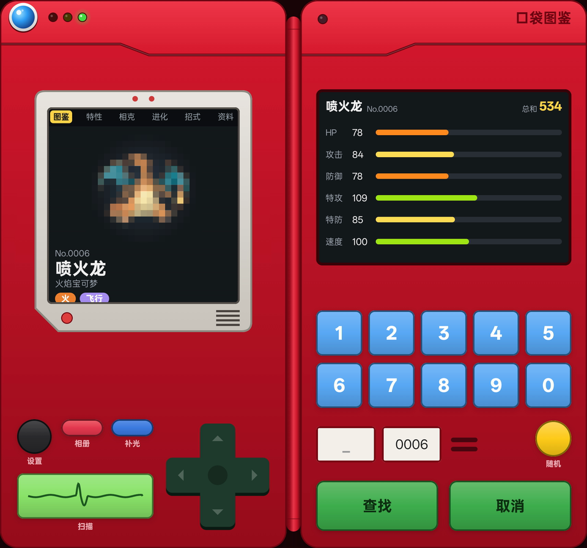
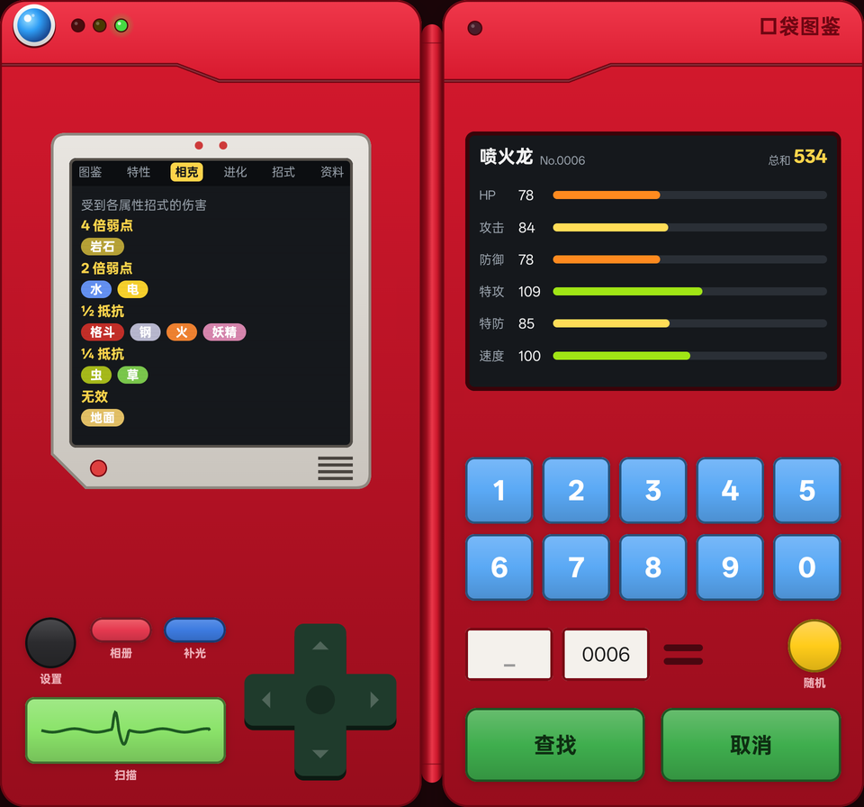
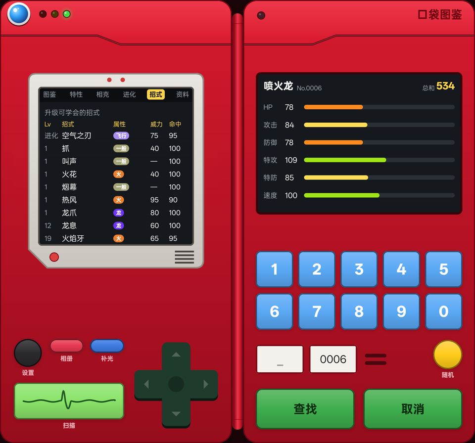
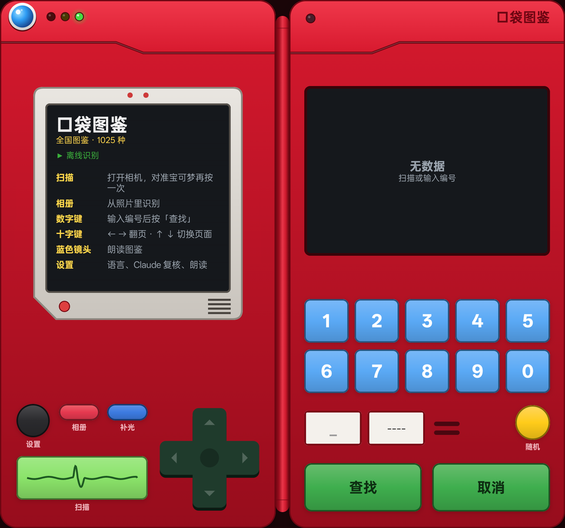

# 口袋图鉴 PocketDex

[English](README.md) | **中文**

一个给折叠屏（OPPO Find N2）做的宝可梦图鉴 App：展开后左右两半就是图鉴的两页。左边用相机拍宝可梦并识别，右边显示种族值、数字键盘和按钮。

## 截图

<p>
  
  
  
  
</p>

在展开的 OPPO Find N2 上截取。截图里的宝可梦立绘特意打了马赛克，App 里显示的是从 PokeAPI 下载的官方立绘。

## 功能

- **离线识别**：手机上直接跑 ViT 模型，覆盖到第九世代全部 1025 只宝可梦。不需要联网，也不花钱。
- **Claude 复核（可选）**：本地模型的置信度低于 50% 时，可以自动把照片发给 Claude 再认一次；也可以手动点「Claude 复核」。需要在设置里填 API Key。
- **离线图鉴**：名字、分类、身高体重、属性、特性（含隐藏特性）、种族值和雷达图、图鉴描述、属性相克、进化链和进化条件、升级招式、捕获率、性别比例、蛋群。
- **中文 / English**：在设置里切换，界面、图鉴内容和朗读都会跟着变。第一次打开时跟随手机的系统语言。
- 从**相册**选图识别、**补光**灯、十字键**缩放**、蓝色镜头**朗读**图鉴（用系统自带的语音）。
- **立绘只下载一次**：App 和这个仓库里都不带宝可梦图片。第一次打开时，App 会在后台从 [PokeAPI](https://github.com/PokeAPI/sprites) 下载全部 1025 只的官方立绘（约 130MB，只在 Wi-Fi 下载），在手机上缩成 256px 保存（约 12MB）。当前正在看的那只会马上下载，用流量时也会。下载完之后整个 App 都能离线使用。
- 折叠后在外屏也能用，两页会改成上下排列。

## 操作

| 控件 | 作用 |
|---|---|
| 绿色「扫描」 | 打开相机；相机开着时再按一次，就拍下取景框里的画面去识别 |
| 红色小键「相册」 | 从照片里选图识别 |
| 蓝色小键「补光」 | 相机开着时打开或关闭闪光灯 |
| 十字键 | ← → 翻到上一只或下一只 · ↑ ↓ 切换页面（相机开着时 ↑ ↓ 是缩放）· 按住会连续翻 |
| 数字键 + 查找 | 按全国图鉴编号查找 |
| 取消 | 清空输入，或返回上一步 |
| 黄色「随机」 | 随机显示一只 |
| 蓝色大镜头 | 朗读或停止朗读当前图鉴 |
| 黑色「设置」 | 语言、Claude API Key 和模型、自动朗读、提示音 |

## 编译和安装

需要 JDK 17 和 Android SDK（`local.properties` 里的 `sdk.dir`）。

```bash
export JAVA_HOME=/opt/homebrew/opt/openjdk@17
./gradlew assembleRelease          # 约 130MB，用本机的 debug 证书签名
adb install -r app/build/outputs/apk/release/app-release.apk
```

`assembleDebug` 也可以用，只是 APK 更大。debug 版带一个测试入口，可以拿 App 私有目录里的图片直接识别：

```bash
adb push pikachu.jpg /data/local/tmp/t.jpg
adb shell run-as app.pocketdex cp /data/local/tmp/t.jpg files/test.jpg
adb shell am start -n app.pocketdex/.MainActivity --es test_image test.jpg
```

手机这边要先打开 USB 调试：设置 → 关于本机 → 版本信息 → 连点「版本号」7 次 → 返回到「系统设置 → 开发者选项」→ 打开「USB 调试」。ColorOS 第一次通过 USB 安装时，手机上会弹出确认框。

API Key 可以在 App 的设置里填，也可以写进 `local.properties` 编译进自己的安装包（`ANTHROPIC_API_KEY=...`）。用第二种方式编出来的 APK 不要发给别人。

**ColorOS 把 App 显示成中间一条窄窗？** 在 Find N2 内屏上，ColorOS 会先用兼容模式打开新装的 App。点屏幕左上角的切换按钮，再点「重启」就能切到全屏，系统会按 App 记住这个设置。

在 Find N2 上，蓝色大镜头正好盖在前置摄像头孔上，顶部不用再空出一条。镜头位置是运行时从系统读的：折叠后会移到外屏摄像头的位置，换别的手机也会自动适配。

英文朗读需要系统里装有英文语音。没有的话，App 会提示你去系统的「文字转语音」设置里安装。

## 工程结构

```
app/src/main/
  assets/dex.json                     离线图鉴数据，中英双语（由 PokeAPI CSV 生成）
  assets/model/pokemon_vit_int8.onnx  识别模型（int8 量化，88MB）
  java/app/pocketdex/
    data/      图鉴数据加载、立绘下载和缓存、设置、语言
    ml/        本地 ONNX 识别（多尺度中心裁剪）、Claude 复核
    ui/        左右两页、按键、十字键、相机取景、属性雷达图、界面文字
    util/      朗读、提示音
tools/         重新生成 dex.json 和 ONNX 模型的脚本
```

## 复用的开源资源

- 识别模型：[skshmjn/Pokemon-classifier-gen9-1025](https://huggingface.co/skshmjn/Pokemon-classifier-gen9-1025)（Apache-2.0，ViT-base 在 1025 只宝可梦上微调），已导出为 ONNX 并做了 int8 量化
- 图鉴数据：[PokeAPI](https://github.com/PokeAPI/pokeapi) 的 CSV 数据；PokeAPI 缺的中文图鉴描述来自 [42arch/pokemon-dataset-zh](https://github.com/42arch/pokemon-dataset-zh)（MIT）
- 立绘：运行时从 [PokeAPI/sprites](https://github.com/PokeAPI/sprites) 下载，仓库里不包含

宝可梦及所有相关的名字、图片和图鉴文本版权归 Nintendo / Creatures Inc. / GAME FREAK inc. / The Pokémon Company 所有。本项目是非官方的爱好者学习项目，与上述公司无关，也未获其认可。

## 许可协议

PocketDex 自己的代码采用 [PolyForm Noncommercial License 1.0.0](LICENSE.md)（非商业许可）。任何**非商业**用途都可以免费使用、复制、修改和分享，包括个人项目、学习、研究、教学，以及慈善机构、学校和公共机构的使用。**不允许商业用途。**

识别模型、图鉴数据来源和 Gradle wrapper 各自沿用原来的协议，详见 [THIRD_PARTY_NOTICES.md](THIRD_PARTY_NOTICES.md)。协议的法律文本以英文原文为准。
